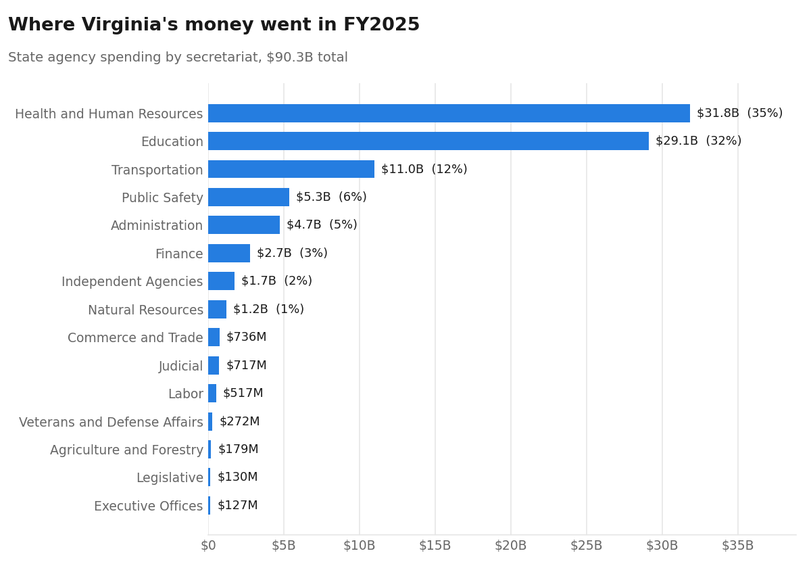
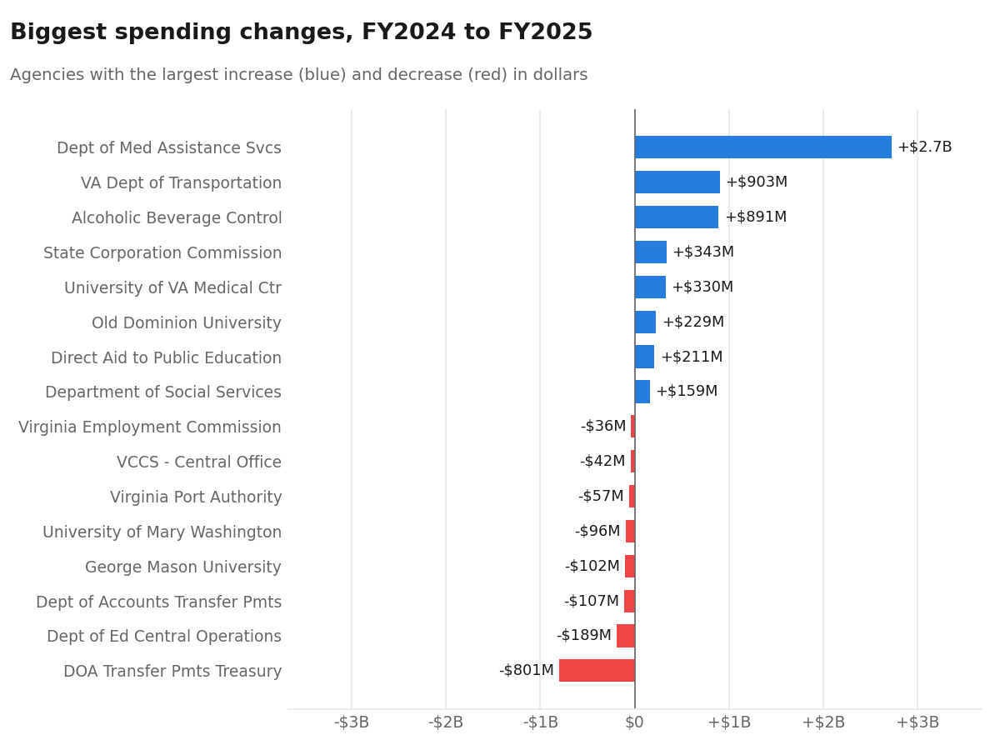
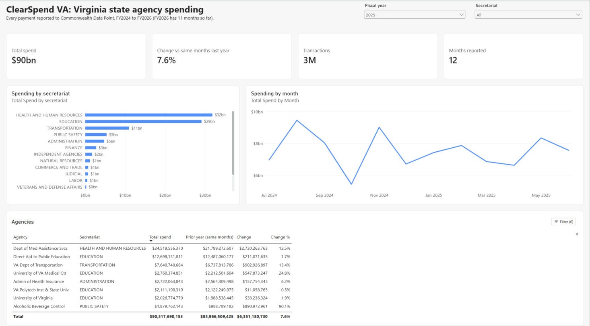
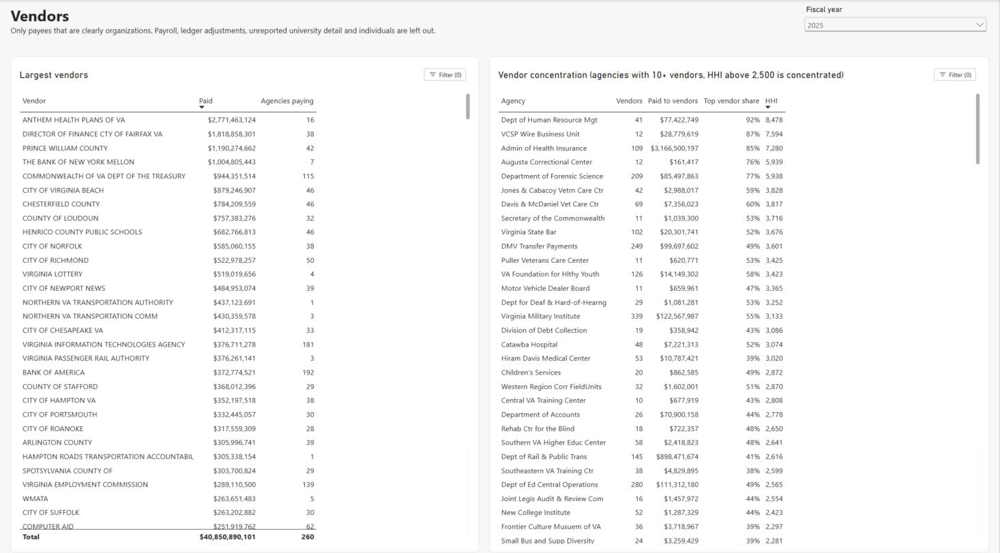
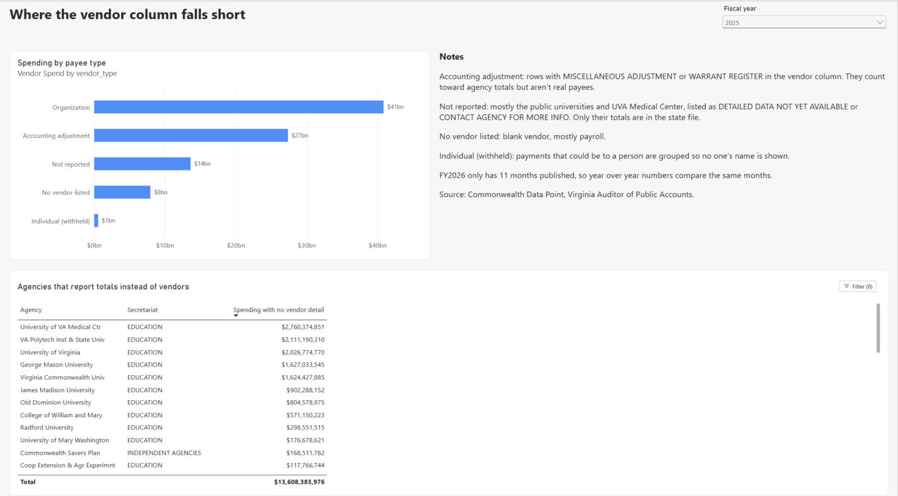

# ClearSpend VA


ClearSpend VA takes every expenditure transaction Virginia state agencies report (about 9 million rows across FY2024 to FY2026) and turns it into a database, a set of SQL views, a written findings report and a Power BI dashboard.

The data comes from [Commonwealth Data Point](https://www.datapoint.apa.virginia.gov), which the Virginia Auditor of Public Accounts publishes. It's all public, but it comes as one zip per year of 55 to 280 MB monthly CSVs, which is hard to do anything with in raw form. I wanted to see where the money actually goes, and I wanted a project that goes all the way from messy raw files to something a manager could read.

## What the data shows

From [docs/findings.md](docs/findings.md), which the pipeline writes from the database every time it runs:

- Virginia state agencies spent **$90.32B** in FY2025, up **7.6%** from $83.97B in FY2024.
- FY2026 has 11 months published so far, and spending is up **7.3%** over the same 11 months of FY2025.
- Health and Human Resources and Education are **67%** of all spending. Medical Assistance Services (Medicaid) alone was $24.5B in FY2025, up 12.5%, and it's up another 17.6% so far in FY2026.
- The biggest vendor that's clearly an outside organization is Anthem Health Plans of Virginia at $2.77B in FY2025, paid by 16 agencies.
- 21 of the 81 agencies that paid at least $25M to outside organizations had highly concentrated vendor spending (HHI above 2,500).





## How it works

```
Data Point zips ──> clean.py ──> transform.py ──> load.py ──────> SQLite or Azure SQL
 (monthly CSVs)     fix files,    roll 9M rows     star schema           │
                    dates,        up to ~700K                            ├── sql/views.sql (YoY, concentration, rankings)
                    vendors       summary rows                           ├── docs/findings.md + charts
                                                                         ├── data/powerbi/*.csv  ──> Power BI
                                                                         └── Azure OpenAI briefing (optional)
```

The database is a small star schema:

| Table | What's in it |
|---|---|
| `dim_agency` | 285 agencies with their secretariat and branch |
| `dim_vendor` | about 27,000 payees, each tagged as an organization or one of the special groups below |
| `fact_monthly` | spending by agency, month, fund, category and expense type |
| `fact_vendor_year` | spending by agency, vendor and category for each fiscal year |

The views in [sql/views.sql](sql/views.sql) are plain SQL that run on both SQLite and Azure SQL. They use window functions for the year over year change (`LAG`), each secretariat's share of the year, vendor rankings (`RANK`) and a Herfindahl-Hirschman Index for how concentrated each agency's vendor spending is.

## Problems I had to solve in the data

This took most of the time, and it's the part I learned the most from.

- **Most of FY2025 was in a different format.** Eleven of the twelve FY2025 files were exported as space-padded text with no quotes. Any comma inside a value, like `Travel, Personal Vehicle` or `SMITH, JOHN`, splits it into extra columns, and a normal CSV reader either throws an error or drops the row. That was about 1 in 6 rows. The columns are padded to fixed widths though, so the pipeline finds where the real separators are and splits each line on those positions instead.
- **Error messages inside the data.** Some of those files have `SP2-0044: For a list of known commands enter HELP` lines mixed in, left over from the database tool that exported them. They're skipped and counted.
- **Not every "vendor" is a vendor.** About 30% of dollars have `MISCELLANEOUS ADJUSTMENT` or `WARRANT REGISTER` in the vendor column, and about 15% (mostly the universities and UVA Medical Center) say `** DETAILED DATA NOT YET AVAILABLE **` or `CONTACT AGENCY FOR MORE INFO`. Both still count toward agency totals but are kept out of vendor rankings, or the top "vendor" in the state would be a placeholder.
- **People's names.** A lot of payees are individuals getting reimbursements. The pipeline groups anything that could be a person's name as "Individual or small payee (name withheld)" and only shows a name when something marks it as an organization, like `INC`, `COUNTY` or an acronym. It errs toward hiding, so some small businesses get grouped too, which I think is the right tradeoff.
- **The same company spelled different ways.** `Anthem Health Plans of Virginia` and `ANTHEM HEALTH PLANS OF VA` are merged by uppercasing, stripping punctuation and legal suffixes, and standardizing a few words.
- **A partial year.** FY2026 is missing June so far, so comparing it to a full FY2025 would make every agency look like it shrank. The partial year is compared month for month against the same months of the year before.

## Run it

Needs Python 3.10 or newer.

```bash
git clone https://github.com/clint-caccia/clearspend-va.git
cd clearspend-va
pip install -r requirements.txt

python run.py                       # downloads FY2024 to FY2026 (about 340 MB) and builds everything
python run.py --years 2025 2026     # just some years
python run.py --skip-download       # use zips you already put in data/raw/
```

If the download gets blocked, download the "All Expenditures for Fiscal Year" zips from Data Point in your browser and put them in `data/raw/`.

What you get:

- `data/clearspend.db` SQLite database with the tables and views
- `data/powerbi/` the same tables and views as CSV, which the Power BI project reads
- `docs/findings.md` and `docs/img/` the written report and charts

Tests:

```bash
pip install -r requirements-dev.txt
pytest
```

## Azure SQL (optional)

1. Create a free Azure SQL Database (the serverless free offer works fine for this size).
2. In the server's networking settings, add your IP address to the firewall.
3. `pip install -r requirements-azure.txt` and install the Microsoft ODBC Driver 18 for SQL Server.
4. Set the connection string and run the pipeline:

```powershell
$env:AZURE_SQL_CONNECTION_STRING = "mssql+pyodbc://<user>:<password>@<server>.database.windows.net/<database>?driver=ODBC+Driver+18+for+SQL+Server"
python run.py --skip-download
```

If your password has special characters like `@` or `#`, URL-encode them in the string. It loads the same four tables and creates the same views, so Power BI can point at Azure SQL instead of the CSV files.

## AI briefing (optional)

If the Azure OpenAI variables are set, `run.py` sends the finished findings report (aggregated numbers only, no transactions) to a model deployment and saves a short plain-English briefing to `docs/ai_summary.md`. The prompt tells it to only use numbers that are in the report and to say "the data doesn't show" instead of guessing at causes. See [clearspend/ai_summary.py](clearspend/ai_summary.py) for the variables.

## Power BI dashboard

The dashboard is saved as a Power BI project in [powerbi/](powerbi/), so the report and the model are text files in the repo. It has three pages, and each one has a fiscal year slicer.

**Overview:** totals, change vs the same months last year, spending by secretariat and by month, and every agency with its prior year and change.



**Vendors:** the largest outside organizations, and how concentrated each agency's vendor spending is.



**Data notes:** where the money goes when the vendor column isn't a real vendor, and which agencies only report totals.



[powerbi/README.md](powerbi/README.md) covers how to open it, the model and the DAX measures, including a prior year measure that only compares matching months.

## Project layout

```
run.py                  pipeline entry point
clearspend/
  download.py           gets the yearly zips from Data Point
  clean.py              file parsing, dates, refunds, vendor cleanup and privacy grouping
  transform.py          rolls transactions up into the two fact tables
  load.py               builds the star schema, loads SQLite or Azure SQL
  charts.py             README charts
  insights.py           writes docs/findings.md
  ai_summary.py         optional Azure OpenAI briefing
sql/views.sql           analysis views
powerbi/                Power BI project (report + model as text files) and DAX measures
tests/                  pytest tests, including both FY2025 file formats
```

## Limitations

- These are cash payments recorded in the state accounting system, not budgets or appropriations, so they won't match budget documents line for line.
- Big changes for some agencies come from accounting moves, not real spending changes. For example `DOA Transfer Pmts Treasury` drops from $801M to almost nothing in FY2025 and comes back in FY2026.
- The vendor rankings leave out about half of all dollars (ledger adjustments, unreported university detail, payroll and individuals), so they describe the identifiable organizations only.

## Author

Clint Caccia, Computer Information Systems, James Madison University
[Portfolio](https://clint-caccia.github.io) · [LinkedIn](https://www.linkedin.com/in/clint-caccia-b70428354)

Data: Commonwealth Data Point, Virginia Auditor of Public Accounts. Code is MIT licensed.
