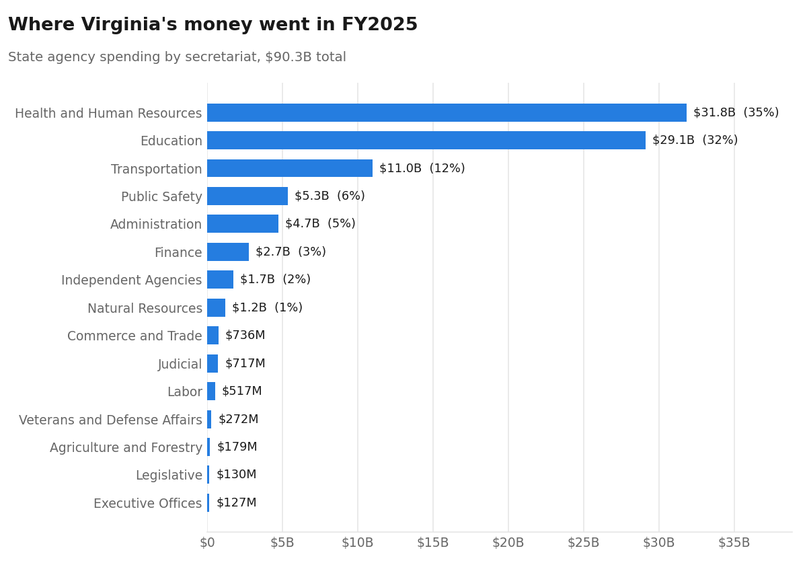
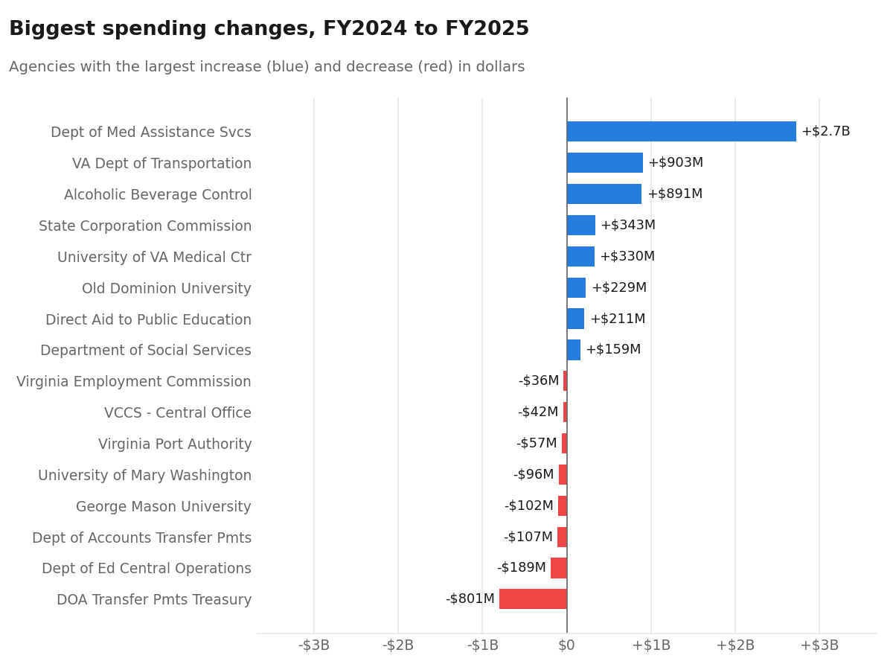
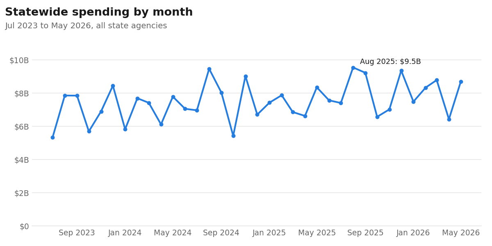

# ClearSpend VA findings

Generated by `run.py` from Virginia's Commonwealth Data Point expenditure files. All figures are net of refunds and reversals. Fiscal years run July 1 to June 30.

## The big picture

- Virginia state agencies spent **$90.32B** in FY2025, +7.6% from $83.97B in FY2024.
- FY2026 only has 11 months published so far. Over those same 11 months, spending was **$88.83B**, +7.3% compared to the same months of FY2025.
- Health and Human Resources and Education together made up **67%** of FY2025 spending.
- By type of spending, the largest buckets were contractual services (37%), transfer payments (32%) and personal services (17%).

## Top 10 agencies, FY2025

| Agency | Secretariat | FY2025 | Change vs prior year |
|---|---|---|---|
| Dept of Med Assistance Svcs | Health and Human Resources | $24.52B | +12.5% |
| Direct Aid to Public Education | Education | $12.70B | +1.7% |
| VA Dept of Transportation | Transportation | $7.64B | +13.4% |
| University of VA Medical Ctr | Education | $2.76B | +13.6% |
| Admin of Health Insurance | Administration | $2.72B | +6.2% |
| VA Polytech Inst & State Univ | Education | $2.11B | -0.5% |
| University of Virginia | Education | $2.03B | +1.9% |
| Alcoholic Beverage Control | Public Safety | $1.88B | +90.1% |
| George Mason University | Education | $1.63B | -5.9% |
| Virginia Commonwealth Univ | Education | $1.62B | +8.1% |

## Biggest changes, FY2024 to FY2025

**Largest increases**

| Agency | FY2024 | FY2025 | Change | % |
|---|---|---|---|---|
| Dept of Med Assistance Svcs | $21.80B | $24.52B | $2.72B | +12.5% |
| VA Dept of Transportation | $6.74B | $7.64B | $902.9M | +13.4% |
| Alcoholic Beverage Control | $988.8M | $1.88B | $891.0M | +90.1% |
| State Corporation Commission | $156.4M | $499.1M | $342.7M | +219.1% |
| University of VA Medical Ctr | $2.43B | $2.76B | $329.5M | +13.6% |

**Largest decreases**

| Agency | FY2024 | FY2025 | Change | % |
|---|---|---|---|---|
| DOA Transfer Pmts Treasury | $800.9M | $119,697 | -$800.8M | -100.0% |
| Dept of Ed Central Operations | $380.5M | $191.3M | -$189.2M | -49.7% |
| Dept of Accounts Transfer Pmts | $511.1M | $403.9M | -$107.1M | -21.0% |
| George Mason University | $1.73B | $1.63B | -$101.8M | -5.9% |
| University of Mary Washington | $272.9M | $176.7M | -$96.2M | -35.2% |

## FY2026 so far (11 months vs the same months of FY2025)

**Growing fastest in dollars**

| Agency | FY2025 | FY2026 | Change | % |
|---|---|---|---|---|
| Dept of Med Assistance Svcs | $22.89B | $26.92B | $4.03B | +17.6% |
| DOA Transfer Pmts Treasury | $119,697 | $810.3M | $810.2M | n/a |
| Lottery Wire Business Unit | $482.8M | $805.9M | $323.1M | +66.9% |
| Virginia Port Authority | $557.8M | $787.2M | $229.3M | +41.1% |
| VA Dept of Transportation | $6.81B | $7.02B | $217.9M | +3.2% |

**Shrinking most in dollars**

| Agency | FY2025 | FY2026 | Change | % |
|---|---|---|---|---|
| Alcoholic Beverage Control | $1.81B | $870.2M | -$936.9M | -51.8% |
| Direct Aid to Public Education | $11.53B | $11.23B | -$297.4M | -2.6% |
| Virginia Lottery | $258.2M | $139.0M | -$119.2M | -46.2% |
| George Mason University | $1.53B | $1.42B | -$106.4M | -7.0% |
| Dept of Environmental Quality | $529.6M | $425.5M | -$104.1M | -19.7% |

## Spending by month

Monthly spending ranged from $5.33B (July 2023) to $9.54B (August 2025), with a typical month around $7.49B.

## Largest vendors, FY2025

Only payees that are clearly organizations are ranked. People, payroll and ledger adjustments are left out (see data notes).

| Vendor | Paid | Agencies paying |
|---|---|---|
| Anthem Health Plans of VA | $2.77B | 16 |
| Director of Finance Cty of Fairfax VA | $1.82B | 38 |
| Prince William County | $1.19B | 42 |
| The Bank of New York Mellon | $1.00B | 7 |
| Commonwealth of VA Dept of the Treasury | $944.4M | 115 |
| City of Virginia Beach | $879.2M | 46 |
| Chesterfield County | $784.2M | 46 |
| County of Loudoun | $757.4M | 32 |
| Henrico County Public Schools | $682.8M | 46 |
| City of Norfolk | $585.1M | 38 |

## Where one vendor gets most of the money

Of the 84 agencies that paid at least $25M to outside organizations in FY2025, **22** were highly concentrated (HHI above 2,500, a common cutoff for a concentrated market). High concentration isn't automatically a problem, since some agencies exist to pay one big contractor or managed care plan, but it's where a vendor change or contract dispute would hurt most. The table skips accounts with fewer than 10 vendors, since those are mostly pass-through accounts (wire business units, treasury disbursement accounts) that exist to send money to one place.

| Agency | Vendors | Paid to vendors | Top vendor share | HHI |
|---|---|---|---|---|
| Dept of Human Resource Mgt | 41 | $77.4M | 92% | 8,478 |
| Commonwealth Savers Plan | 158 | $189.8M | 89% | 7,890 |
| VCSP Wire Business Unit | 12 | $28.8M | 87% | 7,594 |
| Admin of Health Insurance | 109 | $3.17B | 85% | 7,280 |
| Department of Forensic Science | 209 | $85.5M | 77% | 5,938 |
| DMV Transfer Payments | 249 | $99.7M | 49% | 3,601 |
| Virginia Military Institute | 339 | $122.6M | 55% | 3,133 |
| Department of Accounts | 26 | $70.9M | 44% | 2,778 |
| Dept of Rail & Public Trans | 145 | $898.5M | 41% | 2,616 |
| Dept of Ed Central Operations | 280 | $111.3M | 49% | 2,565 |

## Data notes

| Year | Months | Transactions | Unreadable | Refunds/reversals | No vendor | Individual (withheld) | Ledger adjustments |
|---|---|---|---|---|---|---|---|
| FY2024 | 12 | 3,140,325 | 0 | 205,623 | 701,114 | 393,117 | 489,980 |
| FY2025 | 12 | 3,136,055 | 5 | 184,961 | 718,386 | 401,882 | 390,752 |
| FY2026 | 11 | 2,778,995 | 0 | 160,918 | 648,109 | 349,332 | 323,181 |

- **Ledger adjustments.** About 30% of FY2025 dollars carry "MISCELLANEOUS ADJUSTMENT" or "WARRANT REGISTER" in the vendor column instead of a real payee. They count toward agency totals but are left out of vendor rankings.
- **Vendor detail not reported.** About 15% of dollars, almost all from the public universities and UVA Medical Center, are listed as "** DETAILED DATA NOT YET AVAILABLE **". Those schools mostly run their own financial systems, which is likely why the state file only has their totals. Their spending counts toward agency totals but can't be broken down by vendor.
- **No vendor.** About 9% of dollars have a blank vendor, which is mostly payroll.
- **People are never named.** Payments to individuals (0.6% of dollars) are grouped as "Individual or small payee (name withheld)". The rule errs toward hiding, so some small businesses end up in that group too.
- **FY2025 file format.** Most FY2025 monthly files were exported as padded text with no quotes, so commas inside values ("Travel, Personal Vehicle") break a normal CSV reader and would silently drop about 1 in 6 rows. The pipeline splits those files on their fixed column positions instead, and skips the stray SQL*Plus error lines a few of them contain.
- **Partial years.** Year-over-year comparisons for a partial year only use the months both years have.
