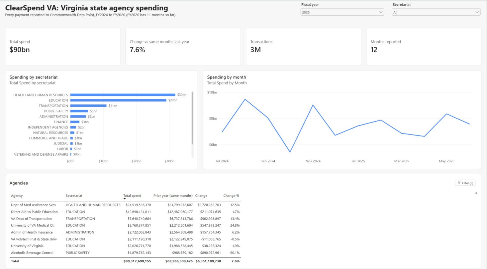

# Power BI dashboard

`clearspend_va.pbip` is the dashboard saved as a Power BI project, so the report and the data model are plain text files (PBIR for the report, TMDL for the model) that can be read and diffed in git.

| Page | What's on it |
|---|---|
| Overview | Fiscal year and secretariat slicers, total spend, change vs the same months last year, transactions, spending by secretariat and by month, and an agency table with prior year and change |
| Vendors | Largest vendors (organizations only) and how concentrated each agency's vendor spending is (HHI) |
| Data notes | How much money falls into each payee group (payroll, ledger adjustments, unreported detail, withheld individuals) and which agencies only report totals |



## Open it

1. Run the pipeline first (`python run.py`) so `data/powerbi/` has the CSV files.
2. Open `clearspend_va.pbip` in Power BI Desktop.
3. Go to **Transform data > Edit parameters** and set `DataFolder` to the full path of your `data/powerbi` folder.
4. Click **Refresh**.

## The model

| Table | From |
|---|---|
| `dim_agency`, `dim_vendor` | dimension CSVs |
| `fact_monthly`, `fact_vendor_year` | fact CSVs |
| `vendor_concentration` | the `v_vendor_concentration` SQL view |
| `FiscalYears` | calculated table, so one year slicer filters every fact table |

Relationships: agencies and vendors are one to many into the fact tables, and `FiscalYears[fiscal_year]` is one to many into `fact_monthly`, `fact_vendor_year` and `vendor_concentration`.

The measures are in [measures.dax](measures.dax). The one worth pointing out is **Prior Year Spend**. FY2026 only has 11 months published, so a plain prior year total would compare 11 months to 12 and make every agency look like it shrank. The measure only counts the months the selected year actually has:

```dax
Prior Year Spend =
VAR fy = SELECTEDVALUE ( FiscalYears[fiscal_year] )
VAR months = VALUES ( fact_monthly[fiscal_month] )
RETURN
    CALCULATE (
        [Total Spend],
        FiscalYears[fiscal_year] = fy - 1,
        TREATAS ( months, fact_monthly[fiscal_month] )
    )
```

## Azure SQL instead of CSV

If you loaded Azure SQL with `run.py`, you can point the same model at it: in **Transform data**, change each query's source to **Azure SQL Database** and pick the table with the same name.
